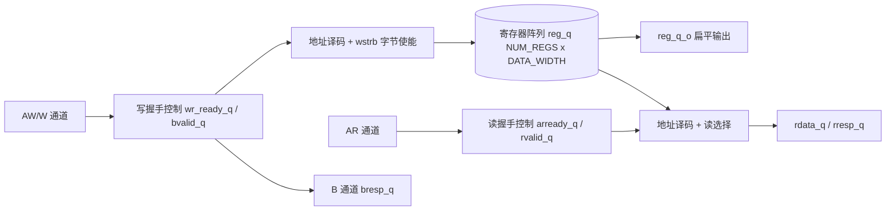
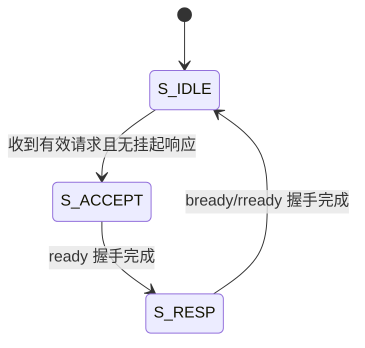

# axil_regs 设计文档

## 1. 概述

- 功能:AXI4-Lite slave 接口的通用寄存器读写模块,软件(主机)可通过 AXI4-Lite 读写内部 NUM_REGS 个 DATA_WIDTH 位寄存器,寄存器值同时以扁平总线输出给硬件逻辑使用。
- 应用场景:IP 的控制/配置寄存器组。
- 数据流:AW/W 通道 -> 地址译码 + 字节使能写入寄存器阵列 -> B 通道返回响应;AR 通道 -> 译码读寄存器 -> R 通道返回数据。

## 2. 参数与端口

### 2.1 参数

| 参数 | 默认 | 含义 |
|---|---|---|
| DATA_WIDTH | 32 | 数据位宽,仅支持 32(strobe 宽度 = DATA_WIDTH/8) |
| ADDR_WIDTH | 6 | 字节地址位宽 |
| NUM_REGS | 16 | 寄存器个数,要求 NUM_REGS * 4 <= 2**ADDR_WIDTH |
| RESET_VAL | 0 | 所有寄存器的复位值 |

### 2.2 端口

| 信号名 | 方向 | 位宽 | 含义 |
|---|---|---|---|
| clk | in | 1 | 时钟,上升沿有效 |
| rst_n | in | 1 | 同步低有效复位 |
| s_axi_awaddr | in | ADDR_WIDTH | 写地址 |
| s_axi_awprot | in | 3 | 忽略 |
| s_axi_awvalid | in | 1 | 写地址有效 |
| s_axi_awready | out | 1 | 写地址就绪 |
| s_axi_wdata | in | DATA_WIDTH | 写数据 |
| s_axi_wstrb | in | DATA_WIDTH/8 | 字节使能 |
| s_axi_wvalid | in | 1 | 写数据有效 |
| s_axi_wready | out | 1 | 写数据就绪 |
| s_axi_bresp | out | 2 | 写响应:OKAY(2'b00) / SLVERR(2'b10) |
| s_axi_bvalid | out | 1 | 写响应有效 |
| s_axi_bready | in | 1 | 写响应就绪 |
| s_axi_araddr | in | ADDR_WIDTH | 读地址 |
| s_axi_arprot | in | 3 | 忽略 |
| s_axi_arvalid | in | 1 | 读地址有效 |
| s_axi_arready | out | 1 | 读地址就绪 |
| s_axi_rdata | out | DATA_WIDTH | 读数据 |
| s_axi_rresp | out | 2 | 读响应:OKAY / SLVERR |
| s_axi_rvalid | out | 1 | 读数据有效 |
| s_axi_rready | in | 1 | 读数据就绪 |
| reg_q_o | out | NUM_REGS*DATA_WIDTH | 全部寄存器当前值(第 i 个寄存器位于 [i*DATA_WIDTH +: DATA_WIDTH]) |

### 2.3 端口时序约定

- 所有输入在 clk 上升沿采样,所有输出由寄存器直接驱动(无组合输出路径,reg_q_o 为寄存器直出)。
- VALID 一旦拉高,在对应 READY 握手完成前不得撤销,且负载保持稳定(AXI 协议要求,由主机保证)。
- 本模块的 READY 不依赖同一通道的 VALID 之外的任何组合路径,BVALID/RVALID 不依赖 BREADY/RREADY。

## 3. 设计方案介绍

### 3.1 总体思路与架构选型

方案 A(选用):写通道"AW 与 W 同时到达才接收"。当 awvalid && wvalid 同时有效且当前没有挂起的 B 响应时,同拍拉高 awready 与 wready(单拍脉冲),同拍完成寄存器写,下一拍起 bvalid=1 直到 bready。读通道类似:arvalid 且没有挂起 R 响应时拉高 arready 一拍,锁存读数据与响应,下一拍 rvalid=1 直到 rready。

方案 B(备选):AW、W 各自独立缓存后再合并写。优点是对主机的到达顺序完全无要求;缺点是多一组地址/数据锁存寄存器与状态,面积和复杂度增加。

选 A 的理由:AXI4-Lite 寄存器访问吞吐要求低;AXI 协议规定主机不得等待 awready 再给出 wvalid(反之亦然),即 slave 等待二者都有效再接收不会死锁,所以 A 合规且最简单、时序最好。

### 3.2 关键设计点

1. 同时接收 AW/W:问题——两通道可能不同拍到达;解决——ready 仅在 awvalid && wvalid && !bvalid 时拉高,先到的通道保持 valid 等待;可行——协议保证 valid 不依赖 ready,不会死锁。
2. 单个 outstanding:问题——响应通道被占用时再收新写会覆盖响应;解决——bvalid 未被 bready 消费前不再接收新写(rvalid 同理);可行——Lite 无 ID,顺序天然保证,吞吐最大 1 笔/2 拍,可接受。
3. 字节使能:问题——部分字节写;解决——按 wstrb 逐字节更新寄存器对应字节;wstrb 全 0 时不改写寄存器,仍返回 OKAY。
4. 地址译码与越界:问题——地址超出寄存器范围或未按字对齐;解决——取 addr[ADDR_WIDTH-1:2] 作为寄存器索引,索引 >= NUM_REGS 则写被丢弃、读返回 0,并返回 SLVERR;低 2 位地址忽略(按字对齐访问)。
5. 读数据:问题——读与写同拍访问同一寄存器的先后关系;解决——读数据在 arready 握手拍锁存(取写入前的旧值),该情形下行为明确且无亚稳态,验证时以此为参考。
6. 复位:异步低有效复位、同步释放(rst_n 由外部同步释放,依据 rtl-style S-2),所有 valid/ready 清零,寄存器恢复 RESET_VAL。

### 3.3 寄存输出握手实现(修订 3.2 第 1、5 点及 2.1 复位描述)

为满足 2.3 节"输出寄存器直出",ready 不做组合输出,改为寄存一拍:

- awready_q/wready_q 共用一个寄存器 wr_ready_q:当 awvalid && wvalid && !bvalid_q && !wr_ready_q 时置 1;下一拍 wr_ready_q=1,此拍与仍保持的 awvalid/wvalid 完成握手并执行寄存器写,同时 bvalid_q 置 1、wr_ready_q 清 0。
- arready_q:当 arvalid && !rvalid_q && !arready_q 时置 1;下一拍握手,此拍锁存读数据和响应,rvalid_q 置 1、arready_q 清 0。
- 依据:AXI 要求 valid 在握手前保持,因此 ready 晚一拍到达时 valid/地址/数据仍然有效;读数据在握手拍采样寄存器旧值(同拍写同一寄存器时读到写入前的值)。
- 代价:写事务 3 拍(检测、握手、响应),吞吐低于 1 笔/3 拍,对寄存器访问可接受。

## 4. 微架构

- 子模块:单模块实现,内部分写通道控制、读通道控制、寄存器阵列三段逻辑。
- 数据通路:写——awaddr/wdata/wstrb 在握手拍直接使用(valid 期间保持),无额外锁存;读——araddr 在握手拍译码,结果锁存到 rdata_q。

## 5. 状态机

写、读通道各有一个两状态握手机,用 bvalid_q/rvalid_q 编码,不单独定义枚举。

| 状态 | 编码(写通道示例) | 输出行为 |
|---|---|---|
| S_IDLE | wr_ready_q=0, bvalid_q=0 | 等待请求 |
| S_ACCEPT | wr_ready_q=1, bvalid_q=0 | ready 有效,完成写寄存器 |
| S_RESP | wr_ready_q=0, bvalid_q=1 | 等待 bready;不接收新请求 |

读通道同理(arready_q / rvalid_q)。wr_ready_q 与 bvalid_q 互斥,为非法组合,断言覆盖。

## 6. 关键时序

写事务(awvalid/wvalid 在 T0 同时有效,bready=1):

| 拍 | 事件 |
|---|---|
| T0 | awvalid && wvalid 有效,wr_ready_q=0,bvalid_q=0 |
| T1 | wr_ready_q=1,握手完成,寄存器在本拍末更新 |
| T2 | bvalid_q=1,bresp 有效;bready=1 则本拍完成响应握手 |
| T3 | bvalid_q=0,可接收下一笔 |

读事务(arvalid 在 T0 有效,rready=1):T1 arready_q=1 并锁存 rdata_q/rresp_q;T2 rvalid_q=1,rready=1 则握手完成;T3 rvalid_q=0。

延迟:写 2 拍到 BVALID,读 2 拍到 RVALID(自 arvalid 有效起算)。AW 与 W 不同拍到达时,先到者保持 valid 等待。

## 7. 复位与初始化

- rst_n 低:wr_ready_q、bvalid_q、arready_q、rvalid_q 清 0;reg_q 全部恢复 RESET_VAL;rdata_q 清 0,bresp_q/rresp_q 为 OKAY。
- 释放后首拍:所有 ready/valid 为 0,首个有效请求按第 6 章时序处理。

## 8. 假设与限制

1. DATA_WIDTH 固定 32,wstrb 为 4 位(假设:最常见场景)。
2. 地址按字对齐,低 2 位忽略(假设)。
3. awprot/arprot 不使用(假设:无安全访问区分)。
4. 越界访问写丢弃、读返回 0,响应 SLVERR(假设:便于软件发现错误)。
5. wstrb 全 0 时不改写寄存器,响应 OKAY(假设)。
6. 同一时刻只处理一笔写、一笔读,读写通道互相独立;同拍读写同一寄存器时读到旧值(假设)。
7. 所有寄存器均为纯读写型,无只读/写 1 清零等特殊寄存器(假设:需求只要求读写)。
8. 异步复位、同步释放,同步释放由外部保证(假设:依据 rtl-style S-2)。
9. 单时钟域,无 CDC(假设)。

